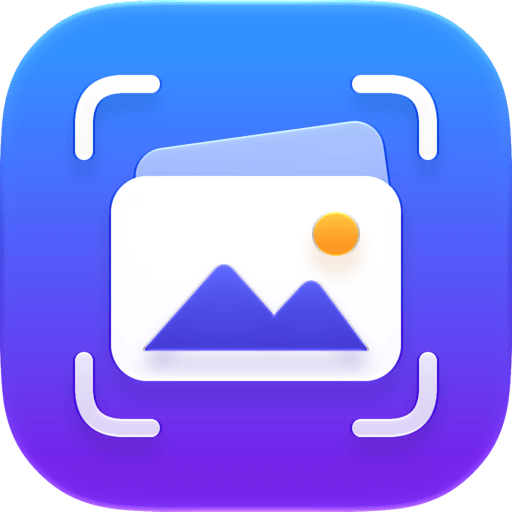
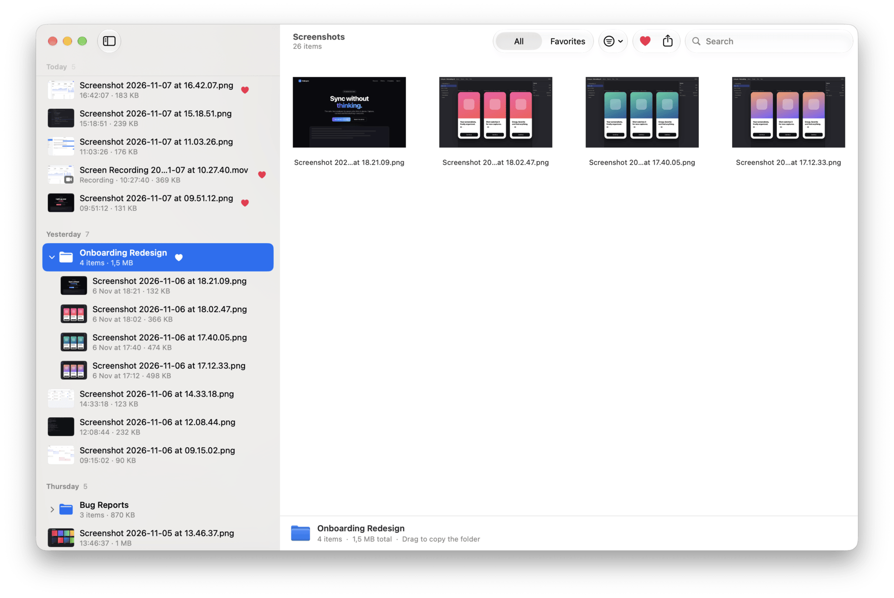
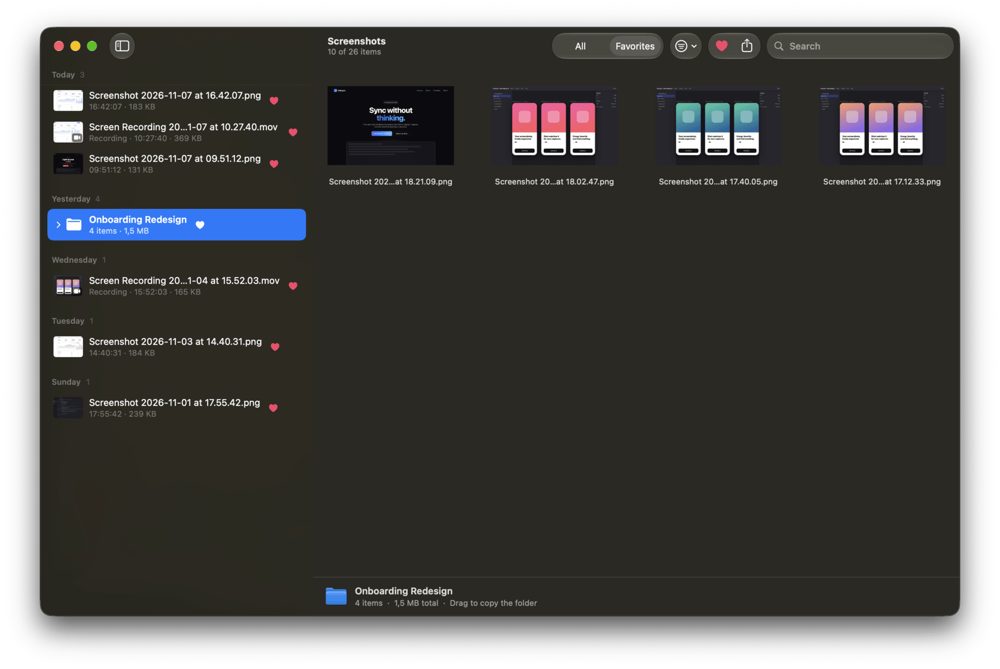

<div align="center">

<picture>
  <source media="(prefers-color-scheme: dark)" srcset="docs/assets/icon-dark.png">
  
</picture>

# Shot

**Your screenshots, beautifully organized.**

A fast, native macOS app for browsing, grouping and finding the screenshots and screen recordings you take every day.

[](https://github.com/eiskrenkov/shot/releases/latest)
[](https://github.com/eiskrenkov/shot/actions/workflows/ci.yml)

[](LICENSE)

[**Download**](https://github.com/eiskrenkov/shot/releases/latest) · [Website](https://iskrenkov.com/shot/) · [Report a bug](https://github.com/eiskrenkov/shot/issues/new?template=bug_report.yml)

</div>

<br>

<picture>
  <source media="(prefers-color-scheme: dark)" srcset="docs/assets/screenshots/dark-landing.png">
  
</picture>

## Why Shot?

macOS saves every screenshot to the same folder with a timestamp for a name. After a week it's a wall of
`Screenshot 2026-11-07 at 16.42.07.png`. Shot turns that folder into a timeline you can actually use, and
it works on your files directly: no import, no database, no lock-in.

## Features

- **Zero setup.** Shot finds the folder macOS saves screenshots to and watches it, so new captures appear instantly.
- **A real timeline.** Screenshots are grouped by day, week or month. You can sort by date, name or size.
- **Screenshots and recordings.** Images get a large preview and recordings play inline. Filter to show either kind.
- **Groups are just folders.** Select some screenshots and press <kbd>⌘</kbd><kbd>G</kbd> to move them into a subfolder. Ungroup or rename any time; Finder sees exactly what you see.
- **Favorites.** Press <kbd>.</kbd> to heart anything, then <kbd>⌘</kbd><kbd>2</kbd> to show only favorites.
- **Find anything.** Search by name with <kbd>⌘</kbd><kbd>F</kbd>, and preview with Quick Look on <kbd>Space</kbd>.
- **Get it out fast.** Copy the image with <kbd>⌘</kbd><kbd>C</kbd>, drag it into any app, share it, open it with another app or move it to the Trash.
- **Native and private.** Built with AppKit. No accounts, no network access, no tracking.

<table>
  <tr>
    <td></td>
    <td></td>
  </tr>
  <tr>
    <td align="center"><sub>Groups are real folders</sub></td>
    <td align="center"><sub>Favorites, in dark mode</sub></td>
  </tr>
</table>

## Install

1. Download the latest `Shot-x.y.z.dmg` from [**Releases**](https://github.com/eiskrenkov/shot/releases/latest).
2. Open the disk image and drag **Shot** to **Applications**.

Shot requires **macOS 14 Sonoma** or later and runs natively on Apple silicon and Intel Macs.

## Keyboard shortcuts

| Action | Shortcut |
| --- | --- |
| Quick Look | <kbd>Space</kbd> or <kbd>⌘</kbd><kbd>Y</kbd> |
| Open in default app | <kbd>⌘</kbd><kbd>O</kbd> |
| Copy | <kbd>⌘</kbd><kbd>C</kbd> |
| Add to / remove from Favorites | <kbd>.</kbd> |
| Group selection | <kbd>⌘</kbd><kbd>G</kbd> |
| Ungroup | <kbd>⇧</kbd><kbd>⌘</kbd><kbd>G</kbd> |
| Show in Finder | <kbd>⇧</kbd><kbd>⌘</kbd><kbd>R</kbd> |
| Search | <kbd>⌘</kbd><kbd>F</kbd> |
| All items / Favorites | <kbd>⌘</kbd><kbd>1</kbd> / <kbd>⌘</kbd><kbd>2</kbd> |
| Change folder | <kbd>⇧</kbd><kbd>⌘</kbd><kbd>O</kbd> |
| Move to Trash | <kbd>⌘</kbd><kbd>⌫</kbd> |

## Build from source

You need Xcode 26 or later; the app icon uses the Icon Composer `.icon` format.

```sh
git clone https://github.com/eiskrenkov/shot.git
cd shot
open Shot.xcodeproj
```

The Xcode project is generated from [`project.yml`](project.yml) with [XcodeGen](https://github.com/yonaskolb/XcodeGen).
After you add or remove files, regenerate it:

```sh
brew install xcodegen
xcodegen generate
```

To build from the command line:

```sh
xcodebuild -project Shot.xcodeproj -scheme Shot -configuration Release build
```

### Project layout

```
Shot/
├── App/         App delegate, main menu
├── Model/       Library scanning and watching, list building, favorites, preferences
├── UI/          Main window, sidebar, preview, settings
└── Resources/   Asset catalog and AppIcon.icon (Icon Composer)
docs/            Website (GitHub Pages) and README images
```

## Releasing

Releases are built by [GitHub Actions](.github/workflows/release.yml). Push a version tag and the workflow
builds a universal app, signs it with a Developer ID certificate, notarizes it, packages a DMG and
publishes a GitHub release:

```sh
git tag v1.0.0
git push origin v1.0.0
```

You can also run the **Release** workflow manually from the Actions tab. The workflow uses these repository secrets:

| Secret | Description |
| --- | --- |
| `MACOS_CERTIFICATE_P12` | Base64-encoded *Developer ID Application* certificate and private key (`base64 -i cert.p12 \| pbcopy`) |
| `MACOS_CERTIFICATE_PASSWORD` | Password of the `.p12` file |
| `APPLE_TEAM_ID` | Your 10-character Apple Developer Team ID |
| `APPLE_ID` | Apple ID email used for notarization |
| `APPLE_APP_SPECIFIC_PASSWORD` | An [app-specific password](https://support.apple.com/102654) for that Apple ID |

Without the signing secrets the workflow still publishes a DMG, but the app is ad-hoc signed and Gatekeeper will warn users when they open it.

## Contributing

Bug reports, ideas and pull requests are welcome. Please read [CONTRIBUTING.md](CONTRIBUTING.md) first.

## License

Shot is released under the [MIT License](LICENSE).
